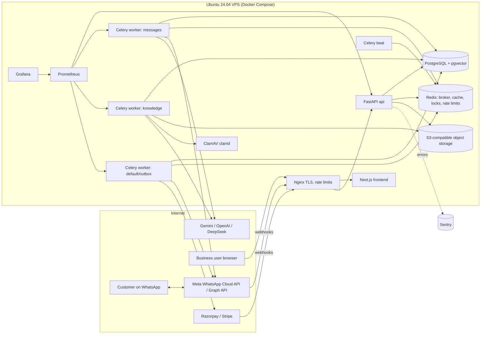
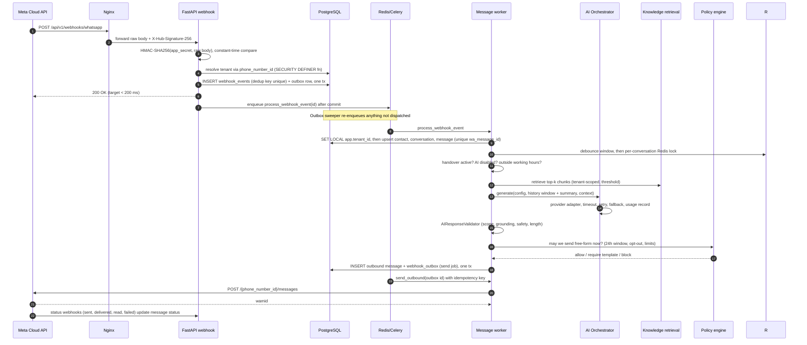
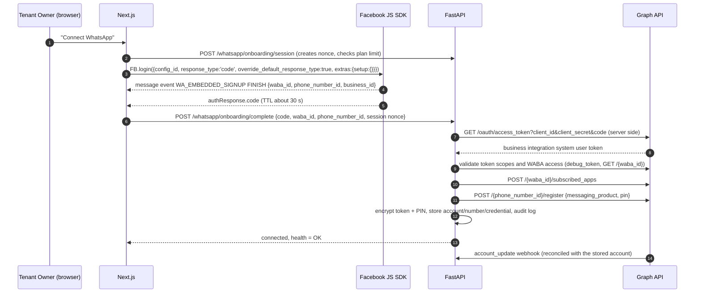
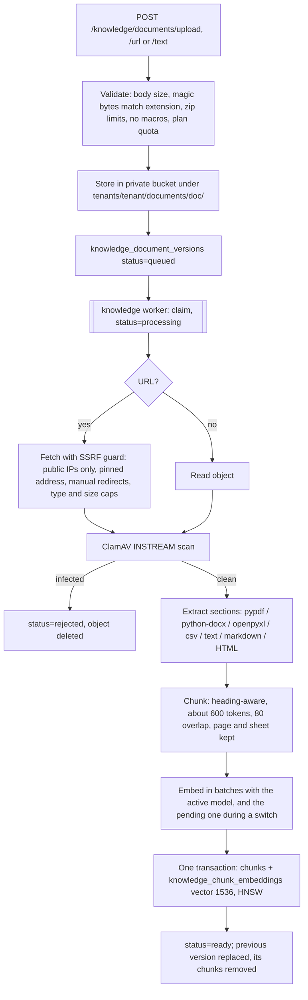

# XploWhatsApp — System Architecture

**Product:** XploWhatsApp, a product of Xplosys
**Document status:** v0.2. Approved 2026-11-12; Phase 1 implemented.
**Last updated:** 2026-11-12

This document covers the "First Task" (section 24 of the master brief): requirements analysis, dependencies and risks, the final architecture, diagrams, the ER model, the repository layout, Meta dependencies (summarised here; full detail in [docs/META_INTEGRATION.md](docs/META_INTEGRATION.md)), security-critical decisions and an Architecture Decision Record (ADR) log. The phased plan and Phase 1 steps are in [docs/IMPLEMENTATION_PLAN.md](docs/IMPLEMENTATION_PLAN.md).

---

## 1. Requirements analysis

### 1.1 What the product is

XploWhatsApp is a self-service, multi-tenant SaaS product. A business signs up, connects its own WhatsApp Business number through Meta Embedded Signup, configures an AI assistant scoped to its own business, uploads its knowledge, and the platform answers inbound customer messages automatically. Human agents can take over at any time. Xplosys does not need to be involved in onboarding.

### 1.2 Functional areas (each maps to a backend module)

| # | Area | Brief section | Module |
|---|------|---------------|--------|
| 1 | Identity, auth, MFA, sessions | 15, 16 | `auth` |
| 2 | Tenants, memberships, invitations, RBAC | 5 | `tenants`, `rbac` |
| 3 | WhatsApp onboarding (Embedded Signup), accounts, numbers, credentials | 6 | `whatsapp.onboarding` |
| 4 | Webhooks: verification, signature, persistence, dedup, routing | 4, 6 | `whatsapp.webhooks` |
| 5 | Outbound messaging, templates, delivery status | 6, 11 | `whatsapp.messaging` |
| 6 | Messaging policy engine (service window, templates, opt-out, limits, pricing) | 11 | `policy` |
| 7 | AI orchestration (providers, registry, catalogue, fallback, usage, validation) | 7 | `ai` |
| 8 | Assistant configuration and versioning | 10 | `assistants` |
| 9 | Knowledge base and RAG | 8 | `knowledge` |
| 10 | Contacts, conversations, messages, handover, notes, tags, summaries | 9 | `conversations` |
| 11 | Leads and lead activities | 9 | `leads` |
| 12 | Subscriptions, plans, usage metering, invoices, payments | 13 | `billing` |
| 13 | Analytics | 14 | `analytics` |
| 14 | Super Admin | 14 | `admin` |
| 15 | Audit logging | 16 | `audit` |
| 16 | File storage and malware scanning | 8, 16 | `storage` |
| 17 | Observability, health | 18 | `core.observability` |

### 1.3 Non-functional requirements

- **Isolation:** cross-tenant leakage is the top risk. Enforced in three layers: tenant derived from authenticated membership, tenant-aware repositories, and PostgreSQL Row Level Security (RLS) as the backstop. Vector search is subject to the same RLS.
- **Webhook latency:** acknowledge Meta in well under a second. Only signature check, parse, persist and enqueue happen in the request.
- **Reliability:** inbox/outbox persistence, idempotent workers, dedup on Meta message IDs, retries with exponential backoff and a dead-letter state.
- **Ordering:** per-conversation serial processing so replies never go out of order.
- **Scale target:** thousands of tenants on one VPS-class deployment at launch, scaling horizontally by adding API and worker containers. No GPU.
- **Cost efficiency:** one modular monolith image used for API and workers, one PostgreSQL, one Redis.
- **Localisation:** English, Hindi and mixed (Hinglish) conversations; INR first, GBP/USD later.

### 1.4 Things in the brief that need a correction or clarification

These are not silent simplifications. Each is a real constraint, with the compliant alternative adopted.

1. **Meta bans general-purpose AI chatbots on the WhatsApp Business Platform (effective 15 January 2026).** Bots where the AI itself is the product (ChatGPT-style assistants) are not allowed. Bots that serve a business's own customers for that business's purposes are allowed. *Decision:* every assistant is scoped to its tenant's business. The system prompt template, a scope classifier in `AIResponseValidator`, and the fallback/handover path refuse off-topic, open-ended requests. Marketing copy and onboarding terms must position XploWhatsApp as a customer-service tool, not an AI chatbot service. This needs a legal read of the current WhatsApp Business Solution Terms before launch.
2. **Embedded Signup has moved to v4/v5.** v2 and v3 were deprecated on 15 October 2026. v5 was introduced on 20 October 2026. We build against the current Meta docs (v4 configuration via Facebook Login for Business with products selected in the configuration, `extras: { setup: {} }`; evaluate v5 at Phase 2 start). The Graph API version is a config value (`META_GRAPH_API_VERSION`, currently `v25.0` in Meta examples), never hard-coded.
3. **Who pays Meta.** As a **Tech Provider**, Xplosys does not pay Meta for its customers' messages: each business adds its own payment method in WhatsApp Manager. Only a **Solution Partner** (BSP) shares a credit line and re-bills. *Decision:* launch as a Tech Provider. WhatsApp costs are tracked and estimated per tenant for display and analytics, but are not invoiced by Xplosys. The billing model keeps a `cost_source` field so we can switch to re-billing if Xplosys later becomes a Solution Partner.
4. **DeepSeek has no embeddings API.** It can be a chat provider but not an embedding provider. Embeddings come from OpenAI or Gemini.
5. **Meta pricing is per message (since 1 July 2025), not per conversation.** Categories: marketing, utility, authentication, service. Service replies inside the customer-service window are free, as are utility templates sent inside the window. Rates vary by country and change, so they live in a versioned rate table with effective dates, never in code.
6. **Celery is not asyncio-native.** The brief asks for both Celery and async I/O. *Decision:* each Celery worker process owns one long-lived asyncio event loop and async engine; tasks are thin sync wrappers that run coroutines on that loop. Business logic is shared async code used by both API and workers.
7. **Malware scanning needs a scanner.** The brief forbids unnecessary technologies but requires malware scanning. *Decision:* add a ClamAV (`clamd`) container. This is the one addition beyond the brief's list, and it is required by section 16.
8. **MinIO's community edition is in maintenance mode** (the project stopped publishing community binaries/images and removed the admin console in 2025). *Decision:* code only against the S3 API (`aioboto3`). For local development and tests we use SeaweedFS (pinned `chrislusf/seaweedfs:4.50`, S3 gateway), because MinIO's community images can no longer be pulled (confirmed in Phase 4). For production, choose between a managed S3-compatible service (AWS S3, Cloudflare R2, Backblaze B2) or a maintained self-hosted alternative. This is an open decision for Phase 9.
9. **Stripe in India.** Stripe's India business is restricted for new accounts. *Decision:* Razorpay (Subscriptions + e-mandate) for Indian customers. Stripe for UK/US customers, which will likely need a non-Indian billing entity. The billing module uses a `PaymentGateway` interface so either can be added without touching subscription logic.
10. **Healthcare data.** Hospitals are a target segment. WhatsApp does not offer a HIPAA BAA, so US healthcare PHI cannot be supported. For India, the DPDP Act 2023 and DPDP Rules 2025 apply (consent, purpose limitation, breach notification, retention). For the UK, UK GDPR. *Decision:* treat all message content as personal data, offer per-tenant retention settings, data export and deletion, and mark healthcare as "non-clinical use only" (appointments, timings, FAQs) in terms of service.
11. **Scanned PDFs / images in documents** need OCR. Not GPU-dependent, but heavy. *Decision:* text-layer extraction in Phase 4; OCR (Tesseract) as an optional, flagged feature later.
12. **Inbound media (images, audio, video)** are persisted and shown in the inbox. AI understanding of media (vision, speech-to-text) is out of initial scope; the assistant acknowledges media and can hand over. Flagged as future work, not presented as complete.

---

## 2. Technical dependencies and risks

### 2.1 External dependencies

| Dependency | Needed for | Lead time / gate |
|---|---|---|
| Meta Business Portfolio for Xplosys, **business verification** | Everything production | Days to weeks; documents required |
| Meta Developer App (Business type) with WhatsApp product | Cloud API, webhooks | Immediate |
| **Tech Provider** onboarding + **App Review** + **Advanced Access** for `whatsapp_business_management`, `whatsapp_business_messaging` | Onboarding businesses that are not ours | Weeks; needs a working demo and screencast |
| Facebook Login for Business configuration (`config_id`) | Embedded Signup | Immediate, but only usable by app roles until approved |
| Public HTTPS domain (api.xplowhatsapp.com) | Webhooks, OAuth allowed domains | DNS + TLS |
| Privacy policy, terms, data-deletion URL | App Review | Legal drafting |
| Gemini, OpenAI, DeepSeek API accounts | AI | Immediate |
| Razorpay account (KYC), Stripe account | Billing | Days to weeks |
| Ubuntu 24.04 VPS, SMTP provider for email verification | Deploy, auth emails | Immediate |
| Sentry project | Error reporting | Immediate |

### 2.2 Risk register

| ID | Risk | Likelihood | Impact | Mitigation |
|---|---|---|---|---|
| R1 | Cross-tenant data leak | Med | Critical | RLS with `FORCE`, non-owner DB role, tenant from membership, isolation test suite in CI that tries every table |
| R2 | Meta App Review / Tech Provider approval delayed or rejected | High | High | Start the Meta process in Phase 1 in parallel; build Phase 2 against Meta's test WABA/number so code is not blocked |
| R3 | Meta AI-chatbot policy enforcement against the product | Med | Critical | Business-scoped assistants, scope validator, positioning, legal review |
| R4 | Meta API changes (versions, ESU, pricing) | High | Med | Version in config, adapter layer, contract tests on recorded payloads, changelog watch |
| R5 | Webhook loss or duplication | Med | High | Persist-then-ack, unique dedup keys, outbox relay sweeper, idempotent handlers |
| R6 | Out-of-order or duplicate AI replies | Med | High | Per-conversation advisory lock, short debounce window, idempotency key per reply |
| R7 | AI hallucinating prices/timings/policies | High | High | RAG with relevance threshold, "answer only from context" prompt, validator, fallback/handover when no context |
| R8 | Prompt injection via customer messages or uploaded docs | High | High | Delimited untrusted content, instruction hierarchy, output validation, no tool execution from model output in v1 |
| R9 | Credential theft (Meta tokens, AI keys) | Low | Critical | Envelope encryption, key rotation, never sent to frontend, masked logs, least-privilege DB role |
| R10 | Cost blow-up on platform-managed AI keys | Med | High | Per-tenant quotas, hard caps, pre-flight token estimate, usage alerts |
| R11 | Single VPS failure | Med | High | Encrypted off-site backups, tested restore runbook, documented RTO/RPO, path to managed Postgres |
| R12 | Regulatory (DPDP, UK GDPR, healthcare) | Med | High | Retention controls, DSR export/delete, DPA template, healthcare usage limits |
| R13 | MinIO community edition stagnation (materialised: images unavailable) | Med | Low | S3 API only; SeaweedFS in dev and tests; production provider by config |
| R14 | pgvector filtered-search recall with per-tenant filter | Med | Med | pgvector ≥ 0.8 iterative HNSW scans, tenant-scoped query, recall tests |

---

## 3. Final system architecture

### 3.1 Style

A **modular monolith** (one Python codebase, one Docker image) deployed as several process types: `api` (FastAPI/Uvicorn), `worker-messages`, `worker-knowledge`, `worker-default`, and `beat` (Celery scheduler). Modules talk through service interfaces, not through each other's tables. No microservices.

### 3.2 Container view



PostgreSQL, Redis, object storage and ClamAV are on an internal Docker network only. Nothing but Nginx publishes ports.

### 3.3 Inbound message flow



### 3.4 Embedded Signup flow (Tech Provider)



The browser never sees the token. The code is exchanged immediately because of its short lifetime. Message-event payloads from the browser are treated as hints and re-verified server-side against Graph API.

### 3.5 Knowledge ingestion flow



No database transaction is open while the file is fetched, scanned, read or embedded. If the business changed its embedding model meanwhile, the store step requeues the version instead of saving vectors from the wrong model.

### 3.6 AI orchestration design

- `AIProvider` (abstract): `generate(request) -> AIResult`, `embed(texts)`, `health_check()`, `estimate_cost(usage)`. Each adapter maps provider errors into one error taxonomy (`ProviderTimeout`, `ProviderRateLimited`, `ProviderAuthError`, `ProviderContentBlocked`, `ProviderUnavailable`, `ProviderBadRequest`).
- Adapters: `GeminiAdapter` (google-genai SDK), `OpenAIAdapter` (openai SDK), `DeepSeekAdapter` (OpenAI-compatible endpoint, own base URL and catalogue entries). All network calls use async clients with explicit timeouts.
- `AIRegistry`: maps provider key to adapter class; adapters are constructed per call with the tenant's resolved credential (tenant key or platform key if the plan allows).
- `ModelCatalogue`: DB-backed (`ai_models`, with prices in `ai_model_prices`) with context window, max output, capabilities, and **versioned prices** (input/output per 1M tokens, currency, effective_from). No prices in code.
- `AIOrchestrator`: builds the prompt (system template + tenant config + summary + recent window + retrieved context), enforces token budget, calls the primary provider with retries on retryable errors, then the configured fallback chain (only providers the tenant enabled), records usage, and returns a result with provenance (provider, model, chunks used).
- `AIResponseValidator`: grounding check (prices/times/numbers in the answer must appear in retrieved context or the assistant config), business-scope check, length and WhatsApp formatting limits (4096 chars), PII/secret leakage check, refusal pattern detection. Failure leads to fallback message or handover, never to sending an unvalidated answer.
- `AIUsageService`: one `usage_records` row per call (tokens, cost estimate, provider, model, key source), used for quotas and billing.

### 3.7 Messaging policy engine

Independent of AI. Every outbound send goes through `PolicyEngine.evaluate(tenant, number, contact, message_kind)`:

1. Opt-out: contact opted out means block everything except legally required messages.
2. Customer-service window: free-form allowed only within 24 h of the contact's last inbound message. Outside it, only approved templates.
3. Template checks: template exists, status `APPROVED`, category matches intent (marketing/utility/authentication), language available, parameters valid.
4. Marketing requires recorded opt-in.
5. Number health: quality rating and messaging limit tier; pause marketing when quality is low.
6. Cost estimate: category plus recipient country lookup in the versioned rate table, recorded on the message.

Window, categories and limits follow Meta's current policies; rules are data-driven so they can be updated without code changes.

### 3.8 Conversation processing rules

- **Ordering:** a short debounce window (default 2 s, `AI_REPLY_DEBOUNCE_SECONDS`) merges bursts of messages into a single AI turn: each inbound message schedules a reply job, and a job that is no longer for the latest inbound message stops. A per-conversation Redis lock (`ai_reply_lock:{conversation}`) serialises the rest. A Postgres advisory lock was the first plan, but it would hold a database connection open for the whole provider call (ADR 004).
- **Handover (Phase 5):** `conversations.ai_enabled = false` stops automatic replies; a `human_handover_sessions` row records each period people answer (started by the assistant, by a person taking over, or by turning AI off; at most one open per conversation by a partial unique index). The assistant handing over sets `needs_human`; a person taking over clears it; "Hand back to AI" closes the session and turns replies back on. There is no automatic expiry: a conversation stays with people until someone hands it back.
- **Assignment:** `assigned_user_id` (any active member). Agents may pick up an unassigned conversation or let go of their own; supervisors and above may assign anyone. Removing a member returns their conversations, open takeovers and leads to the shared queue.
- **Inbox state:** `awaiting_reply` is set by a customer message (not a reaction) and cleared by a reply from a person or the assistant; `closed_at` is set when closed and cleared when the customer writes again.
- **Summaries (Phase 5):** one `conversation_summaries` row per conversation, written by a worker task with the assistant's model chain from the last 80 messages (transcript treated as data), on AI handover (assistant setting `summary_on_handover`, on by default) or on request. Staleness is shown as messages since. Not used as model context.
- **Unanswered questions (Phase 5):** each AI handover records the customer's question, the reason and the number of passages retrieved in `unanswered_questions`, listed on the Knowledge page for owners and admins to resolve or dismiss.

---

## 4. Multi-tenancy and RLS design

- **Tenant ID source:** the access JWT carries `sub` (user) and `tid` (active tenant). `tid` is set only by the server at login or `POST /auth/switch-tenant` after a membership check. Each request re-validates membership and role through a short-TTL Redis cache. Any `tenant_id` in a request body is ignored.
- **Database roles:**
  - `xplo_owner`: owns schema, runs Alembic migrations. Never used by the app.
  - `xplo_app`: used by API and workers. `NOBYPASSRLS`, not the table owner, so RLS always applies.
  - `xplo_admin`: used only by the Super Admin module through a separate engine. `BYPASSRLS`, every use audited and MFA-gated.
- **Policies:** every tenant-owned table has `tenant_id uuid not null`, `ENABLE` and `FORCE ROW LEVEL SECURITY`, and a policy `USING (tenant_id = current_setting('app.tenant_id', true)::uuid) WITH CHECK (same)`. If the setting is missing, `current_setting(..., true)` returns NULL and no rows match, so the default is fail-closed.
- **Setting context:** a session dependency opens a transaction and runs `SELECT set_config('app.tenant_id', :tid, true)` (transaction-local, safe with connection pooling). Workers do the same from the tenant ID stored on the event.
- **Webhook routing:** before the tenant is known, the webhook calls `app_resolve_tenant_by_phone_number_id(text)`, a narrow `SECURITY DEFINER` function that returns only the tenant ID and number ID.
- **Global tables (no tenant_id):** `users`, `refresh_tokens` (user-scoped), `subscription_plans`, `ai_models`, `ai_model_prices`, pricing/rate catalogues. These are read-only for `xplo_app` where possible.
- **Composite foreign keys:** child tables reference `(tenant_id, id)` of parents, so a row cannot point at another tenant's parent even through a bug.
- **Tests:** a generated test iterates every RLS table and asserts that tenant A's context cannot select, update or delete tenant B's rows, and cannot insert rows for B.

---

## 5. Database ER diagram

UUID primary keys (UUIDv7 generated in the app for index locality), `timestamptz` in UTC, `created_at`/`updated_at` on every table. `T` marks tenant-owned tables under RLS.

```mermaid
erDiagram
  tenants ||--o{ tenant_memberships : has
  users ||--o{ tenant_memberships : has
  tenants ||--o{ tenant_invitations : issues
  users ||--o{ refresh_tokens : owns
  tenants ||--o{ whatsapp_accounts : connects
  whatsapp_accounts ||--o{ whatsapp_numbers : has
  whatsapp_accounts ||--o{ whatsapp_credentials : secured_by
  whatsapp_accounts ||--o{ message_templates : owns
  tenants ||--o{ bot_configurations : configures
  bot_configurations ||--o{ bot_configuration_versions : versions
  whatsapp_numbers }o--o| bot_configurations : uses
  tenants ||--o{ ai_provider_configs : sets
  ai_models ||--o{ ai_model_prices : priced_by
  tenants ||--o{ contacts : has
  contacts ||--o{ conversations : has
  whatsapp_numbers ||--o{ conversations : on
  conversations ||--o{ messages : contains
  conversations ||--o| conversation_summaries : summarised_by
  conversations ||--o{ conversation_notes : noted
  conversations ||--o{ unanswered_questions : asked
  messages ||--o| unanswered_questions : question
  users ||--o{ conversations : assigned
  conversations ||--o{ human_handover_sessions : handed_over
  users ||--o{ human_handover_sessions : agent
  tenants ||--o{ webhook_events : receives
  webhook_events ||--o{ webhook_outbox : produces
  messages ||--o{ webhook_outbox : sent_via
  tenants ||--o{ knowledge_documents : uploads
  knowledge_documents ||--o{ knowledge_document_versions : has
  knowledge_document_versions ||--o{ knowledge_chunks : split_into
  knowledge_chunks ||--o{ knowledge_chunk_embeddings : embedded_as
  ai_models ||--o{ knowledge_chunk_embeddings : by_model
  tenants ||--o| knowledge_settings : configures
  contacts ||--o{ leads : becomes
  conversations ||--o{ leads : source
  leads ||--o{ lead_activities : logs
  subscription_plans ||--o{ subscriptions : priced_by
  tenants ||--o{ subscriptions : subscribes
  subscriptions ||--o{ billing_invoices : bills
  billing_invoices ||--o{ billing_transactions : paid_by
  tenants ||--o{ usage_records : meters
  tenants ||--o{ audit_logs : records

  tenants {
    uuid id PK
    string name
    string slug UK
    string status
    string country
    string timezone
    string default_language
    jsonb settings
    timestamptz deleted_at
  }
  users {
    uuid id PK
    citext email UK
    string password_hash
    bool email_verified
    bool is_super_admin
    string mfa_secret_enc
    bool mfa_enabled
    timestamptz last_login_at
  }
  tenant_memberships {
    uuid id PK
    uuid tenant_id FK
    uuid user_id FK
    string role
    string status
    unique tenant_id_user_id UK
  }
  tenant_invitations {
    uuid id PK
    uuid tenant_id FK
    citext email
    string role
    string token_hash UK
    timestamptz expires_at
    timestamptz accepted_at
  }
  refresh_tokens {
    uuid id PK
    uuid user_id FK
    uuid tenant_id
    uuid family_id
    string token_hash UK
    timestamptz expires_at
    timestamptz revoked_at
    uuid replaced_by
    inet ip
    string user_agent
  }
  whatsapp_accounts {
    uuid id PK
    uuid tenant_id FK
    string waba_id UK
    string meta_business_id
    string name
    string status
    string health
    timestamptz last_health_check_at
  }
  whatsapp_numbers {
    uuid id PK
    uuid tenant_id FK
    uuid account_id FK
    string phone_number_id UK
    string display_phone_number
    string verified_name
    string quality_rating
    string messaging_limit_tier
    string status
    uuid bot_configuration_id FK
  }
  whatsapp_credentials {
    uuid id PK
    uuid tenant_id FK
    uuid account_id FK
    string kind
    bytea ciphertext
    bytea nonce
    string key_version
    timestamptz expires_at
    timestamptz revoked_at
  }
  bot_configurations {
    uuid id PK
    uuid tenant_id FK
    string name
    int active_version
    bool auto_reply_enabled
    unique tenant_id UK
  }
  bot_configuration_versions {
    uuid id PK
    uuid tenant_id FK
    uuid bot_configuration_id FK
    int version
    jsonb config
    uuid created_by
    unique config_id_version UK
  }
  ai_provider_configs {
    uuid id PK
    uuid tenant_id FK
    string provider
    string key_source
    text api_key_ciphertext
    string key_version
    string key_hint
    bool enabled
    bool last_test_ok
  }
  ai_models {
    uuid id PK
    string provider
    string model_id
    string display_name
    int context_window
    int max_output_tokens
    jsonb capabilities
    bool active
    unique provider_model_id UK
  }
  ai_model_prices {
    uuid id PK
    uuid model_pk FK
    numeric input_per_mtok
    numeric output_per_mtok
    numeric cached_input_per_mtok
    string currency
    timestamptz effective_from
    unique model_effective_from UK
  }
  contacts {
    uuid id PK
    uuid tenant_id FK
    string wa_id
    string phone_e164
    string name
    string language
    text_array tags
    string opt_in_status
    timestamptz opted_out_at
    unique tenant_id_wa_id UK
  }
  conversations {
    uuid id PK
    uuid tenant_id FK
    uuid contact_id FK
    uuid number_id FK
    string status
    bool ai_enabled
    bool needs_human
    uuid assigned_user_id FK
    timestamptz assigned_at
    bool awaiting_reply
    timestamptz closed_at
    timestamptz last_inbound_at
    timestamptz service_window_expires_at
  }
  conversation_summaries {
    uuid id PK
    uuid tenant_id FK
    uuid conversation_id FK "unique"
    string status
    text summary
    string error
    string provider
    string model
    int message_count
    uuid last_message_id
    timestamptz generated_at
  }
  conversation_notes {
    uuid id PK
    uuid tenant_id FK
    uuid conversation_id FK
    uuid author_user_id FK
    text body
  }
  unanswered_questions {
    uuid id PK
    uuid tenant_id FK
    uuid conversation_id FK
    uuid message_id FK "unique"
    text question
    string reason
    int retrieval_hits
    string status
    uuid resolved_by_user_id FK
  }
  messages {
    uuid id PK
    uuid tenant_id FK
    uuid conversation_id FK
    string direction
    string sender_type
    string type
    text body
    jsonb payload
    string media_object_key
    string wa_message_id
    string status
    string pricing_category
    numeric cost_estimate
    jsonb ai_provenance
    timestamptz wa_timestamp
    unique tenant_id_wa_message_id UK
  }
  webhook_events {
    uuid id PK
    uuid tenant_id
    string source
    string dedup_key UK
    jsonb payload
    string status
    int attempts
    text last_error
    timestamptz received_at
    timestamptz processed_at
  }
  webhook_outbox {
    uuid id PK
    uuid tenant_id
    string kind
    uuid aggregate_id
    jsonb payload
    string idempotency_key UK
    string status
    int attempts
    timestamptz next_attempt_at
  }
  knowledge_settings {
    uuid id PK
    uuid tenant_id FK
    uuid embedding_model_pk FK
    uuid pending_embedding_model_pk FK
    text reindex_error
    numeric min_score
    int top_k
  }
  knowledge_documents {
    uuid id PK
    uuid tenant_id FK
    string title
    string source_type
    string source_url
    int active_version
    int latest_version
  }
  knowledge_document_versions {
    uuid id PK
    uuid tenant_id FK
    uuid document_id FK
    int version
    string status
    string object_key
    string sha256
    string file_type
    bigint size_bytes
    string scan_result
    string error_code
    int attempts
    int chunk_count
  }
  knowledge_chunks {
    uuid id PK
    uuid tenant_id FK
    uuid document_id FK
    uuid version_id FK
    int ordinal
    string heading
    text content
    jsonb meta
    int token_estimate
  }
  knowledge_chunk_embeddings {
    uuid id PK
    uuid tenant_id FK
    uuid chunk_id FK
    uuid model_pk FK
    vector embedding
  }
  message_templates {
    uuid id PK
    uuid tenant_id FK
    uuid account_id FK
    string name
    string language
    string category
    string status
    jsonb components
    string meta_template_id
    unique account_name_language UK
  }
  human_handover_sessions {
    uuid id PK
    uuid tenant_id FK
    uuid conversation_id FK
    string started_by
    uuid agent_user_id FK
    string reason
    timestamptz started_at
    timestamptz released_at
    uuid released_by_user_id FK
  }
  leads {
    uuid id PK
    uuid tenant_id FK
    uuid contact_id FK
    uuid conversation_id FK
    string title
    string status
    string source
    numeric value
    string currency
    uuid owner_user_id FK
    timestamptz closed_at
  }
  lead_activities {
    uuid id PK
    uuid tenant_id FK
    uuid lead_id FK
    string type
    jsonb data
    uuid actor_user_id
  }
  subscription_plans {
    uuid id PK
    string code UK
    string name
    string interval
    jsonb limits
    jsonb prices
    bool active
    int version
  }
  subscriptions {
    uuid id PK
    uuid tenant_id FK
    uuid plan_id FK
    string status
    timestamptz trial_ends_at
    timestamptz current_period_start
    timestamptz current_period_end
    int extra_seats
    string gateway
    string gateway_subscription_id
    bool cancel_at_period_end
  }
  billing_invoices {
    uuid id PK
    uuid tenant_id FK
    uuid subscription_id FK
    string number UK
    string currency
    numeric subtotal
    numeric tax
    numeric total
    jsonb line_items
    string status
    string gstin
    timestamptz issued_at
  }
  billing_transactions {
    uuid id PK
    uuid tenant_id FK
    uuid invoice_id FK
    string gateway
    string gateway_payment_id UK
    numeric amount
    string currency
    string status
    jsonb raw
  }
  usage_records {
    uuid id PK
    uuid tenant_id FK
    string metric
    numeric quantity
    string unit
    numeric cost_estimate
    string currency
    string cost_source
    jsonb dimensions
    timestamptz occurred_at
  }
  audit_logs {
    uuid id PK
    uuid tenant_id
    uuid actor_user_id
    string action
    string target_type
    uuid target_id
    jsonb diff
    inet ip
    timestamptz occurred_at
  }
```



### 5.1 Key indexes and constraints

- `messages (tenant_id, wa_message_id)` unique (partial, where not null): inbound dedup.
- `messages (tenant_id, conversation_id, wa_timestamp)`: timeline reads.
- `conversations (tenant_id, status, last_inbound_at desc)`: inbox list.
- `contacts (tenant_id, wa_id)` unique; trigram index on `name`, `phone_e164` for search.
- `webhook_events (dedup_key)` unique. Dedup key is the Meta message ID for messages, and `wamid + status + timestamp` for statuses.
- `webhook_outbox (status, next_attempt_at)` partial index where status in (`pending`, `retry`).
- `whatsapp_numbers (phone_number_id)` unique globally (routing).
- `knowledge_chunk_embeddings` HNSW on `embedding vector_cosine_ops`, unique `(chunk_id, model_pk)`, plus `(tenant_id, model_pk)` btree. Searches run with `hnsw.iterative_scan = relaxed_order` so tenant filtering keeps recall.
- `usage_records (tenant_id, metric, occurred_at)`; monthly partitioning of `messages`, `usage_records`, `webhook_events`, `audit_logs` introduced when volume justifies (designed for, not done in Phase 1).
- **Embedding dimension:** standardised at 1536 (OpenAI `text-embedding-3-small` natively; Gemini embeddings with `output_dimensionality=1536`). Changing the embedding model triggers a re-index; vectors live in `knowledge_chunk_embeddings` keyed by model, so the new model's vectors are added beside the old ones and the switch is one update (ADR 027). Retrieval only compares vectors from the tenant's active model.

---

## 6. Repository structure

```
XploWhatsApp/
├── README.md
├── ARCHITECTURE.md
├── PROJECT_STATUS.md
├── .env.example
├── docker-compose.yml               # local development
├── docker-compose.prod.yml          # production overrides
├── Makefile                         # common commands
├── .github/workflows/
│   ├── ci.yml                       # lint, type-check, tests, build
│   └── deploy.yml                   # tagged release to VPS
├── docs/
│   ├── IMPLEMENTATION_PLAN.md
│   ├── META_INTEGRATION.md
│   ├── SECURITY.md                  # security checklist (Phase 8)
│   ├── DEPLOYMENT_UBUNTU.md         # Phase 9
│   ├── LAUNCH_CHECKLIST.md          # Phase 10
│   ├── API.md                       # generated from OpenAPI plus notes
│   └── adr/                         # one file per decision
├── backend/
│   ├── pyproject.toml               # uv-managed; ruff, mypy, pytest config
│   ├── Dockerfile
│   ├── alembic.ini
│   ├── alembic/
│   │   ├── env.py
│   │   └── versions/
│   ├── app/
│   │   ├── main.py                  # app factory only
│   │   ├── core/                    # config, logging, errors, security, crypto, rate_limit, observability, ids
│   │   ├── db/                      # base model, engines, session, tenant context, RLS helpers
│   │   ├── api/v1/router.py         # mounts module routers
│   │   ├── modules/
│   │   │   ├── auth/                # router, schemas, service, repository, models, deps, mfa, tokens
│   │   │   ├── tenants/             # tenants, memberships, invitations
│   │   │   ├── rbac/                # roles, permissions, policy checks
│   │   │   ├── whatsapp/
│   │   │   │   ├── onboarding/      # Embedded Signup completion, health, reconnect
│   │   │   │   ├── webhooks/        # verify, signature, parse, persist, route
│   │   │   │   ├── messaging/       # Cloud API client, send, media, templates, status
│   │   │   │   └── graph_client.py
│   │   │   ├── policy/              # messaging policy engine, rate catalogue
│   │   │   ├── ai/
│   │   │   │   ├── providers/       # base.py, gemini.py, openai.py, deepseek.py
│   │   │   │   ├── registry.py
│   │   │   │   ├── orchestrator.py
│   │   │   │   ├── validator.py
│   │   │   │   ├── usage.py
│   │   │   │   ├── catalogue.py
│   │   │   │   └── prompts/
│   │   │   ├── assistants/          # bot configuration + versions
│   │   │   ├── knowledge/           # upload, extractors/, chunking, embeddings, retrieval
│   │   │   ├── conversations/       # contacts, conversations, messages, handover, notes, summaries
│   │   │   ├── leads/
│   │   │   ├── billing/             # plans, subscriptions, usage, invoices, gateways/{razorpay,stripe}
│   │   │   ├── analytics/
│   │   │   ├── admin/               # super admin (separate DB engine)
│   │   │   ├── audit/
│   │   │   └── storage/             # S3 client, ClamAV client
│   │   └── workers/
│   │       ├── celery_app.py
│   │       ├── runtime.py           # per-process event loop and engines
│   │       └── tasks/               # webhooks, messages, outbox, knowledge, maintenance, billing
│   └── tests/
│       ├── conftest.py              # testcontainers Postgres+pgvector, Redis
│       ├── unit/
│       ├── integration/
│       ├── isolation/               # generated cross-tenant tests
│       ├── contracts/               # recorded Meta/AI payloads
│       └── load/                    # Locust or k6 scripts
├── frontend/
│   ├── package.json                 # Next.js (App Router), TypeScript, Tailwind
│   ├── Dockerfile
│   ├── next.config.ts
│   ├── src/
│   │   ├── app/
│   │   │   ├── (auth)/              # login, register, verify-email, accept-invite
│   │   │   ├── (onboarding)/
│   │   │   ├── (dashboard)/         # dashboard, whatsapp, assistant, ai-providers, knowledge,
│   │   │   │                        #  inbox, contacts, leads, analytics, billing, team, settings
│   │   │   └── admin/               # super admin
│   │   ├── components/ui/           # design system primitives
│   │   ├── features/                # feature components + hooks per area
│   │   ├── lib/api/                 # typed client generated from OpenAPI
│   │   └── lib/auth/
│   └── tests/e2e/                   # Playwright
└── infra/
    ├── nginx/                       # nginx.conf, site configs, TLS snippets
    ├── postgres/init/               # roles, extensions (vector, citext, pg_trgm)
    ├── prometheus/
    ├── grafana/dashboards/
    ├── clamav/
    └── scripts/                     # backup.sh, restore.sh, rotate-keys, healthcheck
```

---

## 7. Meta developer requirements (summary)

Full detail, including the approval sequence and what can be built before approval, is in [docs/META_INTEGRATION.md](docs/META_INTEGRATION.md).

1. Meta Business Portfolio for Xplosys, with business verification completed.
2. A Meta Developer App of type Business, with the WhatsApp product added.
3. Tech Provider onboarding, which includes App Review and Advanced Access for `whatsapp_business_management` and `whatsapp_business_messaging` (plus access verification as Meta requires).
4. A Facebook Login for Business configuration for Embedded Signup, giving the `config_id`, with products selected in the configuration.
5. HTTPS domains in Allowed Domains and Valid OAuth Redirect URIs.
6. A webhook callback URL and verify token, subscribed to `messages`, `account_update`, `message_template_status_update`, `phone_number_quality_update` and related fields.
7. Privacy policy, terms of service and a data-deletion URL.
8. Until approval, only businesses with a role on the app can be onboarded, so development uses Meta's test WABA and test number.

---

## 8. Security-critical design decisions

| Area | Decision |
|---|---|
| Passwords | Argon2id (`argon2-cffi`), parameters tuned to ~250 ms on the VPS, rehash on login when parameters change. Breached-password check (k-anonymity HIBP) optional. |
| Access tokens | JWT, ES256, 15 min, `kid` header for key rotation, claims `sub`, `tid`, `role`, `sid`, `mfa`. |
| Refresh tokens | Opaque 256-bit random, stored as SHA-256 hash, 30-day sliding life, rotated on each use. A family ID detects reuse: replaying an old token revokes the whole family. Delivered as an `HttpOnly; Secure; SameSite=Strict` cookie scoped to `/api/v1/auth`, with a CSRF header check. |
| MFA | TOTP (RFC 6238) plus recovery codes. Mandatory for Super Admin, enforceable per tenant for Owner/Admin. Step-up required for credential changes and WhatsApp disconnects. |
| RBAC | Permission matrix (Super Admin, Tenant Owner, Tenant Admin, Supervisor, Support Agent) enforced in a FastAPI dependency per endpoint; tested as a table. |
| Tenant isolation | Membership-derived tenant, tenant-aware repositories, RLS `FORCE` with non-owner role, composite FKs, isolation tests in CI. |
| Secrets at rest | Envelope encryption: AES-256-GCM per secret with a random data key, data key wrapped by a versioned key-encryption key from env (`XPLO_KEK_<version>`). `key_version` stored with each ciphertext; a rotation task re-wraps. Path to a KMS or Vault later. |
| Secrets in transit to frontend | Never. API returns masked values (last 4 chars) only. |
| Webhook authenticity | `X-Hub-Signature-256` HMAC over the raw body with the app secret, constant-time compare, reject before parsing. GET verification compares `hub.verify_token`. Razorpay/Stripe signatures verified the same way. |
| Transport | TLS 1.2+ at Nginx, HSTS, HTTP→HTTPS redirect. Postgres/Redis not published. |
| CORS | Allow-list of app origins only, credentials allowed only for those. |
| Rate limiting | Nginx `limit_req` per IP plus Redis token buckets per user, tenant and endpoint class (auth endpoints strictest). |
| Uploads | Size and type limits, magic-byte sniffing, private bucket, random object keys, ClamAV scan before processing, never served from the API origin; downloads via short-lived presigned URLs. |
| URL ingestion | SSRF guard: resolve DNS, block private/loopback/link-local/metadata ranges, re-check on redirects, size and time limits. |
| Prompt injection | Untrusted content (customer messages, documents) wrapped in delimiters with explicit instruction hierarchy; model output is text only (no tool calls in v1); validator checks scope and grounding; system prompt and keys never echoed. |
| Logging | Structured JSON (structlog), request ID and tenant ID on every line, a redaction processor for tokens, keys, passwords, phone numbers (partially masked) and message bodies in non-debug logs. |
| Audit | Append-only `audit_logs` for auth events, role changes, credential changes, WhatsApp connect/disconnect, config changes, admin actions. |
| Backups | Nightly `pg_dump` (plus WAL archiving later), encrypted with age/GPG before leaving the host, off-site copy, monthly restore test. |
| Dependencies | Pinned lockfiles, Dependabot, `pip-audit` and `npm audit` in CI, container image scanning (Trivy). |

---

## 9. Architecture Decision Records (ADR log)

| ADR | Decision | Status |
|---|---|---|
| 001 | Modular monolith with Celery worker process types, one image | Accepted |
| 002 | Tenant isolation by RLS with `FORCE`, non-owner app role, transaction-local `app.tenant_id` | Accepted |
| 003 | Webhook persist-then-ack with transactional inbox/outbox and sweeper | Accepted (Phase 2) |
| 004 | Debounce plus a per-conversation Redis lock for AI reply ordering (changed from a Postgres advisory lock, which would hold a connection during provider calls); a reply records the inbound message it answers so it is never sent twice | Accepted (Phase 3) |
| 005 | Celery tasks run async code on a per-process event loop | Accepted |
| 006 | Envelope encryption with versioned KEKs from env | Accepted |
| 007 | ES256 JWT access tokens, opaque rotating refresh tokens with reuse detection | Accepted |
| 008 | Embeddings fixed at 1536 dimensions (OpenAI `dimensions`, Gemini `outputDimensionality`); OpenAI or Gemini as embedding providers; a vector of another size is refused | Accepted (Phase 4) |
| 009 | Launch as Meta Tech Provider; customers pay Meta directly | Proposed |
| 010 | S3 API only for storage (`aioboto3`, path-style). SeaweedFS for dev and tests because MinIO community images are gone; production provider decided in Phase 9. Files are never served by the API: downloads are 5-minute presigned links forced to `attachment` and `application/octet-stream` | Accepted (Phase 4) |
| 011 | ClamAV (clamd INSTREAM over TCP) scans every file and fetched page in the worker before it is parsed; required outside development; a scanner outage fails the version (retryable) rather than skipping the scan | Accepted (Phase 4) |
| 012 | Razorpay for India, Stripe for UK/US behind a `PaymentGateway` interface | Proposed |
| 013 | Assistants are business-scoped to comply with Meta's general-purpose chatbot ban | Proposed |
| 014 | Python deps via `uv`, frontend via `pnpm` | Accepted |
| 015 | Frontend calls same-origin `/api` (Next rewrites in dev, Nginx in prod) so the refresh cookie is first-party | Accepted |
| 016 | Visual theme follows xplosys.com (Plus Jakarta Sans, indigo-violet-cyan gradient, light/dark) via one token file | Accepted |
| 017 | Outbound sends are at most once: a job is committed as `sending` before the Meta call, and a stale `sending` job becomes `unknown` (message failed with `send_outcome_unknown`) instead of being resent | Accepted (Phase 2) |
| 018 | Contacts are identified by business-scoped user ID or phone number (at least one required, each unique per tenant); BSUID is matched first | Accepted (Phase 2) |
| 019 | Celery dispatch happens only after the database commit (`run_after_commit`); the beat sweeper covers broker outages and crashes | Accepted (Phase 2) |
| 020 | Webhook routing and cross-tenant sweeps use SECURITY DEFINER functions owned by `xplo_definer` that return only IDs and tenant IDs; `webhook_events.tenant_id` is nullable so unroutable events are kept | Accepted (Phase 2) |
| 021 | AI providers are called with small httpx adapters on each provider's documented REST API, not vendor SDKs: one error taxonomy (retryable or not), one timeout setting, the Gemini key sent in a header, and a transport hook so tests run against fakes | Accepted (Phase 3) |
| 022 | Model IDs and prices live in a platform catalogue (`ai_models`, `ai_model_prices`), never in code. Prices are dated and only superseded, so a past cost estimate can be reproduced; calls to an unpriced model are recorded as `unpriced` | Accepted (Phase 3) |
| 023 | Replies are structured JSON (`reply`, `needs_human`, `out_of_scope`) and pass a validator before sending: shape, length, secrets, prompt leakage, and grounding (prices, percentages, times, phone numbers, emails and links must appear in the business information or the customer's words). A failed answer tries the next model; if none passes, the handover message is sent | Accepted (Phase 3) |
| 024 | A business uses its own API key (envelope-encrypted, bound to tenant and provider) or, if its plan's `platform_ai_keys` limit allows, XploSys's key from the environment | Accepted (Phase 3) |
| 025 | Handover turns AI off for that conversation and marks it `needs_human` until a person turns AI back on; assistant settings are immutable versions so a change can be rolled back | Accepted (Phase 3) |
| 026 | Each knowledge change is a new document version; answers use the active version until a newer one is ready, then the old version's chunks are deleted and its file kept for download until deleted | Accepted (Phase 4) |
| 027 | Chunks and their vectors are separate tables keyed by embedding model, so changing the model re-embeds in batches beside the old vectors and switches in one update; answers keep working during the switch | Accepted (Phase 4) |
| 028 | Web pages are fetched without trusting DNS twice: every hop is resolved, every address must be public, the request goes to the checked IP with the original Host and TLS name, redirects are followed by hand (max 3), ports 80 and 443 only, no proxy settings from the environment | Accepted (Phase 4) |
| 029 | Uploads are checked by content, not by name: magic bytes must match the extension, Office files are opened as zips with entry, size and ratio limits, macro-enabled and legacy binary Office files are refused, text must be UTF-8 or UTF-16 with a byte order mark; the request body is capped before it is read | Accepted (Phase 4) |
| 030 | Retrieval embeds the customer's latest message and their last three messages together in one call and keeps each passage's best score above the business's threshold; retrieved passages go into the prompt as reference material (not instructions) and count as grounding for the validator, and their IDs and scores are kept in the message's provenance | Accepted (Phase 4) |
| 031 | Handover is a session record, not only a flag: `conversations.ai_enabled` stops replies and `human_handover_sessions` keeps who took it, why, and when it went back, with at most one open session per conversation (partial unique index). The old per-conversation AI switch goes through the same takeover and release | Accepted (Phase 5) |
| 032 | Agents can pick up unassigned conversations and leads or let go of their own; reassigning someone else's needs `conversations:assign` (supervisor and above). The same rule applies to lead owners | Accepted (Phase 5) |
| 033 | Inbox search uses `ILIKE`-style substring matching on lowercased contact fields and message bodies, backed by `pg_trgm` GIN indexes created by hand in the migration (and excluded from autogenerate); LIKE wildcards in the query are escaped. Full-text search can replace it if volumes need it | Accepted (Phase 5) |
| 034 | AI summaries run in a worker with the assistant's model chain and are recorded as usage with purpose `summary`; the transcript is wrapped as data; a lost job is re-sent by a sweeper through a definer function | Accepted (Phase 5) |
| 035 | Lead history (`lead_activities`) is append-only for the app role (`UPDATE` and `DELETE` revoked); deleting a lead (supervisors and above) removes its history by cascade and is audited | Accepted (Phase 5) |
| 036 | Analytics are computed at request time from the operational tables (messages, handover sessions, leads, usage records) with indexed range queries, inside the tenant's RLS context; no rollup tables yet. Add daily rollups written by a beat task when a 90-day overview for the largest tenant takes over 500 ms | Accepted (Phase 6) |
| 037 | Analytics days and hours use the business's time zone (`tenants.timezone`, falling back to UTC if invalid); the previous period is the same length immediately before | Accepted (Phase 6) |
| 038 | AI cost is shown only to roles that can configure AI or read billing; supervisors see activity and team figures without spend. WhatsApp charges are counted by Meta's billable flag and category, not priced, until a rate card exists (Phase 7) | Accepted (Phase 6) |
| 039 | Charts are small dependency-free SVG/HTML components with a table view on every chart, keyboard and hover readouts, and a three-colour series palette validated for colour-vision deficiency in light and dark mode | Accepted (Phase 6) |

Each will be written up under `docs/adr/` as it is implemented.
